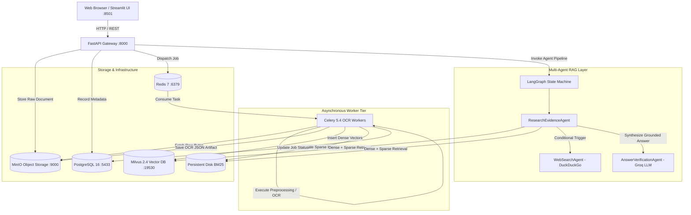

# System Architecture Blueprint

## 1. Overview

The **Distributed OCR + Agentic RAG System** is an enterprise-grade document intelligence platform designed to ingest multi-format corporate documents (PDF, scans, images, Word, Excel, PowerPoint, RTF, HTML, TXT, CSV), extract textual and tabular data with high precision, index content into dual dense/sparse stores, and enable grounded conversational question-answering with multi-agent reasoning, verifiable citations, and anti-hallucination guardrails.

---

## 2. End-to-End System Topology

---

## 3. Infrastructure & Port Mapping

| Service | Internal Port | Host Port | Purpose |
| :--- | :--- | :--- | :--- |
| **PostgreSQL 16** | `5432` | `5433` | Relational document metadata, task logs, query audit logs |
| **Redis 7** | `6379` | `6379` | Celery message broker and task result backend |
| **MinIO Storage** | `9000` / `9001` | `9000` / `9001` | Raw documents, images, and full structured OCR JSON artifacts |
| **Milvus 2.4** | `19530` / `9091` | `19530` / `9091` | Dense vector index for 384-dimensional BGE embeddings |
| **Milvus Etcd** | `2379` | `2379` | Metadata consensus for Milvus |
| **FastAPI Gateway** | `8000` | `8000` | REST API gateway, ingestion, retrieval, and health probes |
| **Streamlit UI** | `8501` | `8501` | Interactive dashboard, document viewer, table export, chat |

---

## 4. Key Subsystems

### 4.1 Ingestion & Cryptographic Deduplication
- **File Validation**: Strict multi-point validation checking file size limits (50MB default), MIME types, and binary magic bytes (`%PDF`, `PK\x03\x04`, `\xFF\xD8\xFF`, etc.).
- **SHA-256 Fingerprinting**: Computes exact file hashes on incoming byte streams. If a file hash already exists in PostgreSQL, deduplication routes the request to the existing document record, preventing redundant OCR computation and storage consumption.

### 4.2 Multi-Format OCR & Preprocessing Pipeline
- **Image Preprocessor**: OpenCV-driven image enhancement:
  - Adaptive thresholding and CLAHE contrast enhancement.
  - Page skew detection and deskewing via minimum area bounding rectangle.
  - Non-local means denoising and unsharp masking.
- **Dynamic OCR Routing**:
  - **Digital PDFs**: Extracted via PyMuPDF native text stream parser in under 50ms.
  - **Scanned PDFs / Images**: Rendered at 300 DPI and processed through Tesseract 5.5 LSTM engine.
  - **Low-Confidence Fallback**: Automatically invokes PaddleOCR if character confidence falls below 60%.
  - **Office Formats**: Direct native structured extraction for `docx`, `xlsx`, `pptx`, `rtf`, `html`, `txt`, `csv`.
  - **Tabular Data**: Table detection engine parsing grid layouts into structured matrices, Pandas DataFrames, and exportable CSVs.

### 4.3 Hybrid Search & Neural Reranking
- **Structure-Aware Chunking**: Preserves page numbers, section boundaries, and keeps tables as standalone atomic chunks.
- **Dense Embeddings**: `BAAI/bge-small-en-v1.5` generating 384-dimensional unit-normalized embeddings indexed in Milvus using `COSINE` distance and `HNSW`/`FLAT` index.
- **Persistent Sparse BM25**: `BM25Plus` with tokenization, disk persistence (`data/bm25_indices/*.pkl`), and fast loading.
- **Reciprocal Rank Fusion (RRF)**: Merges dense vector and sparse keyword candidate rankings using $RRF(d) = \sum_{m} \frac{1}{60 + r_m(d)}$.
- **Cross-Encoder Reranking**: `cross-encoder/ms-marco-MiniLM-L-6-v2` scoring query-passage pairs with neural attention. Includes automatic graceful fallback to RRF in case of model unavailability.

### 4.4 Multi-Agent RAG (LangGraph)
- **`ResearchEvidenceAgent`**: Hybrid search execution and sufficiency evaluation. Scores semantic overlap, query keyword coverage, and determines if external facts are required.
- **`WebSearchAgent`**: DuckDuckGo fallback agent retrieving live web sources when document evidence is insufficient or question requires external knowledge.
- **`AnswerVerificationAgent`**: Grounded answer generation utilizing Groq LLM (Llama 3.1) with XML context isolation boundaries. Validates citations and eliminates hallucinations.
- **Guardrails**: Prompt injection detection, XML isolation tags (`<untrusted_document_context>`, `<untrusted_web_context>`), and verifiable inline citation mapping (`[Doc: ...]`, `[Web: ...]`).
